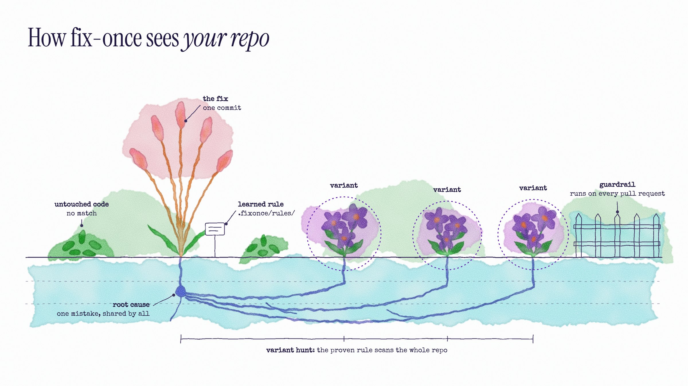
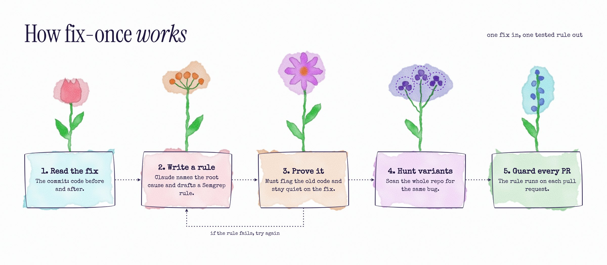

<p align="center">
  
</p>

# fix-once

Fix a vulnerability once, and your repo remembers it.



Point fix-once at a commit that fixed a security bug. It:

1. Reads the fix and works out the root cause.
2. Writes a Semgrep rule for the vulnerable pattern.
3. **Proves the rule** against the fix itself: it must match the code before the fix and must
   not match the code after it. If it fails, the failure is fed back to the model and it tries
   again (3 attempts by default). A rule that never passes is never saved.
4. Scans the rest of the repo with the proven rule and lists **variants**: other places with
   the same bug that the fix did not touch.
5. Saves the rule to `.fixonce/rules/`, where a second workflow runs it on every pull request.

It runs in your own CI with your own API key. There is no server and no account.



## Try it locally

```bash
pip install semgrep .
export ANTHROPIC_API_KEY=...

cd /path/to/some/repo          # any git repo where the last commit fixed a vulnerability
fixonce learn --base HEAD^ --head HEAD
```

A good first target is [OWASP Juice Shop](https://github.com/juice-shop/juice-shop). It is
vulnerable on purpose, so fix one bug yourself (for example, replace a string-built SQL query
with a parameterized one), commit, and run the command above. The repo has other queries built
the same way, which is what the variant hunt should surface.

## Use it as a GitHub Action

1. Push this repo to GitHub and tag a release (`git tag v0 && git push --tags`).
2. In the repo you want to protect, add `ANTHROPIC_API_KEY` under Settings > Secrets > Actions.
3. Copy both files from `examples/workflows/` into `.github/workflows/` as they are.
4. Under Settings > Actions > General, allow GitHub Actions to create pull requests.
5. Label a security fix PR `security-fix`. When it merges, fix-once opens a follow-up PR with
   the rule, the root cause, and the list of variants.

From then on, `fixonce-enforce.yml` fails any PR that reintroduces a learned pattern.

## What to know before trusting it

- **Code leaves the runner.** The diff and the changed files (up to 5 files, 60 KB each) are
  sent to the Anthropic API under your key. Nothing else is sent anywhere.
- **The proof is narrow.** Passing means the rule separates this one fix from this one bug. It
  does not measure false positives elsewhere, so variants are suggestions for a human to review,
  and rules arrive as a PR for the same reason.
- **Some bugs have no static pattern.** Logic flaws and bugs that span many files often cannot be
  expressed as a Semgrep rule. fix-once says so and adds nothing.
- **Squash or merge commits only.** The example workflow diffs the merge commit against its
  parent. Rebase merges with several commits need the manual trigger, once per commit.
- **PR content is untrusted input.** The model is told to treat it as data, and its output is only
  ever used as a Semgrep config that must pass the proof, but review rule PRs like any other PR.

## Layout

```
fixonce/gitdiff.py         what changed, before and after
fixonce/learn.py           the loop: prompt, normalize, prove, hunt
fixonce/semgrep_runner.py  Semgrep CLI wrapper
fixonce/llm.py             model call (swap in any provider here)
fixonce/report.py          markdown report for the PR body
action.yml                 composite GitHub Action
examples/workflows/        learn + enforce workflows to copy
tests/                     end to end tests with a scripted model, real git, real Semgrep
```

## Develop

```bash
pip install -e ".[dev]"
pytest
```
